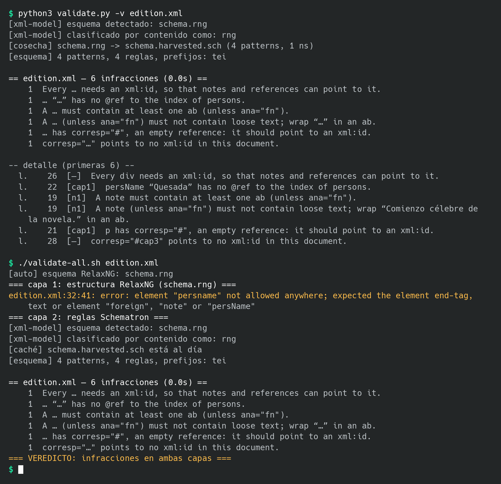
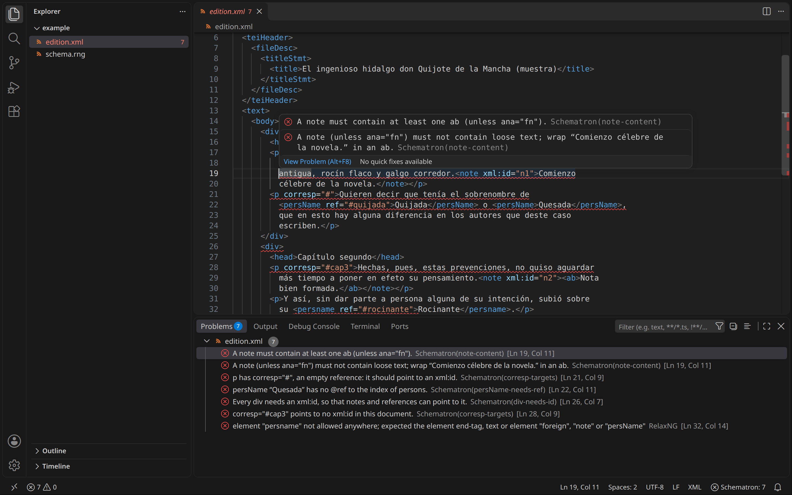
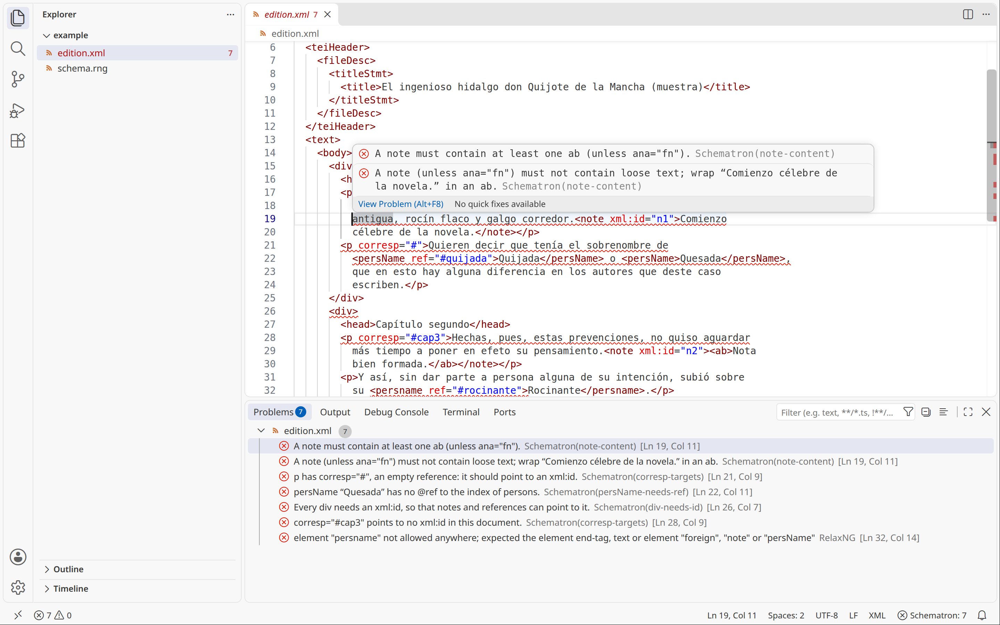

# validate.py — Validación Schematron de documentos TEI, en el terminal y en VS Code

*(English: [README.md](README.md))*

**Versión 1.9** (`validate.py --version`)

Validador de la capa Schematron del proyecto SMTrad. Extrae las reglas ISO
Schematron embebidas en el ODD (`smed-schema.xml`) y las ejecuta contra uno o
más documentos TEI con Saxon (XPath 3.1), produciendo un informe completo —
sin el tope de visualización de oXygen — con recuento por regla y, en modo
detallado, número de línea y `xml:id` de cada infractor.

- **La línea de órdenes** (`validate.py`) ejecuta las reglas Schematron del
  esquema de un documento (un ODD, un archivo ISO Schematron o un RelaxNG
  con las reglas embebidas), que encuentra por sí sola en el
  `<?xml-model?>` del documento. **`validate-all.sh`** añade la capa
  estructural, RelaxNG con jing, y da un solo veredicto para las dos. Véase
  [Uso](#3-uso).
- **La extensión de VS Code** (`vscode/`) muestra los mismos resultados en
  el editor, **mientras se escribe**: los errores subrayados en el texto,
  sus mensajes al pasar el puntero, todos ellos en el panel Problemas
  (Schematron, RelaxNG y buena formación), y el recuento en la barra de
  estado. Descarga el `.vsix` de la última versión publicada
  ([Codeberg](https://codeberg.org/nivaca/py-validate/releases) o
  [GitHub](https://github.com/nivaca/py-validate/releases)) e instálalo con
  `code --install-extension validate-schematron-*.vsix`. Véase
  [Extensión de VS Code](#32-extensión-de-vs-code).

Cómo se hizo se cuenta en [`docs/DESCRIPCIÓN_es.md`](docs/DESCRIPCIÓN_es.md).

**Por qué existe.** oXygen presenta tres modos de fallo silencioso
documentados en la historia de este proyecto: el tope de *validation
highlights* (por defecto 100; los errores excedentes se descartan sin aviso),
el *first-match shadowing* entre reglas con contexto idéntico, y las reglas
estructuralmente vacías que invalidan el esquema entero. Este script elimina
el primero por diseño (lista todo, o avisa exactamente cuántos quedan fuera),
y hace visibles los otros dos al dar siempre un recuento total verificable.

## Capturas de pantalla

`validate.py` y `validate-all.sh` en el terminal, sobre el ejemplo de
[`docs/example/`](docs/example/) (un texto TEI breve con errores
deliberados, y un esquema RelaxNG pequeño con reglas Schematron embebidas):



La extensión de VS Code (§3.2) sobre el mismo documento: los errores
subrayados, el mensaje de uno de ellos, todos en el panel Problems con la
capa que encontró cada uno (Schematron o RelaxNG), y el recuento en la barra
de estado:



y en un tema claro:



Las capturas las hace [`tools/screenshots.py`](tools/screenshots.py), sin
mostrar nada en pantalla y sin tocar tu configuración; su docstring indica
lo que necesita:

```sh
python3 tools/screenshots.py --python ~/.venvs/schematron/bin/python
```

---

## 1. Requisitos

| Componente | Versión | Papel |
|---|---|---|
| Python | ≥ 3.9 | intérprete |
| [saxonche](https://pypi.org/project/saxonche/) | ≥ 12 | motor XSLT 3.0 / XPath 3.1 (Saxon C) |
| [lxml](https://pypi.org/project/lxml/) | ≥ 4.9 | resolución de números de línea |
| `extract-isosch.xsl` + `common/functions.xsl` | TEI Stylesheets (rama `dev`) | extracción ODD → `.sch` (solo con `-o`) |

El binding XPath 3.1 de Saxon es un superconjunto del motor de oXygen, de
modo que `matches()`, `tokenize()`, `some/every … satisfies`, `if/then/else`
y los `<let>` de las reglas se evalúan de forma idéntica en ambos entornos.

## 2. Instalación

```sh
# 1. Dependencias Python
pip install saxonche lxml

# 2. Hojas de estilo TEI (solo necesarias para la extracción con -o).
#    Deben respetar esta estructura de carpetas junto al script, porque
#    extract-isosch.xsl importa ../common/functions.xsl:
mkdir -p odds common
curl -sL -o odds/extract-isosch.xsl \
  https://raw.githubusercontent.com/TEIC/Stylesheets/dev/odds/extract-isosch.xsl
curl -sL -o common/functions.xsl \
  https://raw.githubusercontent.com/TEIC/Stylesheets/dev/common/functions.xsl
```

Disposición resultante:

```
validate/
├── validate.py
├── odds/
│   └── extract-isosch.xsl
└── common/
    └── functions.xsl
```

Las rutas a `odds/` y `common/` se resuelven relativas al script
(`Path(__file__).parent`), no al directorio de trabajo: puedes invocarlo
desde cualquier sitio.

## 3. Uso

```
python3 validate.py [-o ODD | -s SCH | -r RNG] [-v] [--max N] [--refresh] [--json] [--as RUTA] DOC.xml [...]
```

Desde la v1.2, los flags de esquema son **opcionales**: sin ellos, el
esquema se **autodetecta** de las PIs `<?xml-model?>` del primer documento
(§3.1).

| Opción | Efecto |
|---|---|
| `-o, --odd RUTA` | Extrae el `.sch` de un ODD **con Schematron embebido** (con caché, §4) y valida con él. Un ODD sin reglas embebidas (p. ej. `tei_all.odd` sin compilar) se rechaza con aviso, no se valida en vacío (§7) |
| `-s, --sch RUTA` | Usa un `.sch` ya extraído; omite la extracción |
| `-r, --rng RUTA` | **Cosecha** las anotaciones `sch:ns`/`sch:pattern` embebidas en un RelaxNG generado de ODD (deduplicadas, con caché) y valida con ellas — las mismas reglas que Jing ignora |
| `-v, --verbose` | Listado detallado: línea, `xml:id`, mensaje por infractor |
| `--max N` | Máximo de infractores en el detalle (defecto 50). Si hay más, el script **dice cuántos quedaron fuera** — nunca trunca en silencio |

| `--refresh` | Con autodetección: volver a descargar un esquema remoto aunque esté en caché |
| `--json` | Informe legible por máquina en stdout: todas las infracciones (pattern, contexto, assert/report, `role`, mensaje, texto interpolado, `fn:path`, línea, `xml:id`), errores XPath por regla y la fuente del esquema; ignora `-v`/`--max`. Un documento mal formado se convierte en una entrada `error` en lugar de abortar la corrida. Los mensajes de progreso siguen yendo a stderr (lo usa la extensión de VS Code, §3.2) |
| `--as RUTA` | Con un único documento: tratarlo como si estuviera en RUTA, para resolver los hrefs relativos de `xml-model` y para el nombre en el informe. La extensión de VS Code lo usa para validar el texto sin guardar a partir de una copia temporal |

Las tres fuentes explícitas son mutuamente excluyentes; si no se da ninguna,
opera la autodetección.

### 3.1 Autodetección por `<?xml-model?>` (v1.2)

Sin `-o/-s/-r`, el script lee las PIs `xml-model` del primer documento y:

1. **Elige el href**: preferentemente el de `schematypens` Schematron; en su
   defecto, el de RelaxNG (se cosechará su Schematron embebido). El patrón
   habitual — el mismo `.rng` asociado dos veces, una por capa — converge en
   una sola fuente.
2. **Resuelve la ruta**: relativa *al documento* (no al directorio de
   trabajo), absoluta, o URL http(s) — que se descarga a `.schema-cache/`
   junto al script (nombre = hash de la URL + nombre original) y se reutiliza
   en corridas siguientes; `--refresh` fuerza la redescarga. Nota: a
   diferencia de la caché por mtime, la de URL no detecta actualizaciones
   remotas — tras una release nueva del esquema, usa `--refresh`.
3. **Clasifica por contenido real**, no por extensión ni por lo declarado:
   raíz RelaxNG → cosecha; raíz ISO Schematron → uso directo; raíz TEI
   (ODD) → extracción. Con varios documentos, el esquema se detecta del
   primero (con aviso). Sin ninguna PI y sin flags: código 3 con mensaje.

Con ello, la invocación mínima es simplemente:

```sh
python3 validate.py documento.xml
```

### Recetas

```sh
# Ciclo cotidiano: extraer si hace falta y validar
python3 validate.py -o ../smed-schema/smed-schema.xml ../salmarc_ed_lat.xml

# Informe completo para la campaña de corrección
python3 validate.py -o ../smed-schema/smed-schema.xml -v --max 999 \
    ../salmarc_ed_lat.xml > pendientes.txt

# Varios documentos contra un .sch fijo
python3 validate.py -s smed-schema.sch -v ed_lat.xml ed_es.xml

# Contra el Schematron de las Guidelines, cosechado del RNG de tei_all (§7)
python3 validate.py -r tei_all.rng -v documento.xml

# Un solo artefacto para las dos capas: estructura con Jing, reglas con -r
jing smed-schema.rng ed_lat.xml && python3 validate.py -r smed-schema.rng ed_lat.xml

# O con el wrapper bicapa (ejecuta ambas capas SIEMPRE, sin cortocircuito,
# con veredicto compuesto: 0 limpio, 1 RelaxNG, 2 Schematron, 3 ambas, 4 entorno;
# si jing no está instalado usa el RelaxNG de lxml como respaldo):
./validate-all.sh -v smed-schema.rng ed_lat.xml

# Wrapper en modo auto (v1.2): sin esquema, lo detecta de la PI xml-model
# del documento (clasificando el primer argumento por contenido, no por
# extensión) y comparte la caché de descargas de validate.py:
./validate-all.sh -v documento.xml

# En un Makefile o hook pre-commit (código de salida ≠ 0 si hay infracciones)
python3 validate.py -s smed-schema.sch ed_lat.xml || echo "hay pendientes"
```

### Códigos de salida

| Código | Significado |
|---|---|
| 0 | sin infracciones |
| 1 | una o más infracciones |
| 2 | error de invocación (argparse) |
| 3 | error de entorno (archivo inexistente, XSLT ausente, ODD/RNG sin reglas), con mensaje por stderr |

### 3.2 Extensión de VS Code

`vscode/` contiene una extensión para Visual Studio Code que ejecuta
`validate.py --json`, y jing cuando el esquema es RelaxNG, y muestra los
resultados como diagnósticos en el editor y en el panel Problemas:

- **Cuándo:** mientras se escribe (cuando la escritura se detiene medio
  segundo, un ajuste), al abrir y al guardar, en cada archivo `.xml` con un
  `<?xml-model?>`. El texto sin guardar se valida a partir de una copia
  temporal privada; tu archivo nunca se escribe.
- **Qué se ve:** cada error subrayado, con su mensaje al pasar el puntero y
  su capa (**Schematron**, **RelaxNG**, o **XML** cuando el documento no
  está bien formado); un elemento mal escrito se marca donde se abrió. La
  barra de estado muestra el resultado del archivo actual: una marca cuando
  está limpio, el número de problemas, o "failed" cuando la validación no
  pudo ejecutarse.
- **Órdenes** (Ctrl+Shift+P, "Schematron"): *Validate Current File*,
  *Refresh Schema* (volver a descargar un esquema remoto que cambió),
  *Select Python Interpreter…*, *Show Output* y *Clear Diagnostics*.

**Instalación:** descarga `validate-schematron-*.vsix` de la última versión
publicada ([Codeberg](https://codeberg.org/nivaca/py-validate/releases) o
[GitHub](https://github.com/nivaca/py-validate/releases)) y luego

```sh
code --install-extension validate-schematron-*.vsix
```

e indica en `schematron.pythonPath` un Python que tenga saxonche y lxml
(la extensión ofrece elegirlo si hace falta). Lleva su propia copia de
`validate.py`. Para compilarla desde el código fuente:

```sh
cd vscode && npm install && npx vsce package
```

Ajustes, requisitos y detalles en [vscode/README.md](vscode/README.md)
(en inglés).

## 4. Configuración y caché

- **Caché de extracción**: con `-o`, el `.sch` se escribe junto al ODD
  (mismo nombre, extensión `.sch`); con `-r`, junto al RNG (extensión
  `.harvested.sch`). Solo se regeneran si el mtime de la fuente **o del propio
  script** es posterior — actualizar `validate.py` invalida automáticamente
  todos los derivados, de modo que un generador corregido nunca convive con
  derivados producidos por la versión defectuosa. El mensaje `[caché] ... está al día` lo indica. Para forzar la
  regeneración: `touch` a la fuente o borrar el derivado.
- **Prefijos de namespace**: se leen de los `<ns>` del propio `.sch`
  (actualmente solo `tei:`). No hay nada que configurar a mano.
- **Sin archivo de configuración**: todo el estado observable está en la
  línea de órdenes y en los dos artefactos (ODD, `.sch`).

## 5. Funcionamiento interno

### Pipeline

1. **Extracción** (solo `-o`): Saxon aplica `extract-isosch.xsl` al ODD y
   produce el ISO Schematron con `queryBinding="xslt2"` — un `pattern` por
   `constraintSpec`, como hace la cadena TEI estándar.
2. **Carga de reglas**: lxml parsea el `.sch` y construye la lista de
   patterns → reglas → (`context`, `let*`, tests `assert`/`report`).
3. **Ejecución**: para cada regla, los nodos de contexto se localizan con
   Saxon (`//(contexto)` para contextos relativos; los absolutos tal cual) y
   cada test se evalúa como *effective boolean value* en XPath 3.1. Los
   `<let>` se traducen a la expresión nativa `let $x := (...) return (...)`.
4. **Self-check de cosecha** (solo `-r`): el `.harvested.sch` recién
   escrito se re-parsea y sus recuentos se comparan con lo cosechado; si
   difieren (corrupción en la serialización), el script termina con código 3
   en lugar de validar contra un esquema mutilado.
5. **Informe**: recuento agregado por mensaje de regla; con `-v`, cada
   infractor se resuelve a línea física y `xml:id` mediante `fn:path()`
   (Saxon) → conversión de la notación `Q{uri}` a prefijos → localización
   del nodo con lxml (`sourceline` + primer ancestro con `@xml:id`).

### Semántica ISO Schematron implementada

Cubierto — el subconjunto exacto que usa el ODD smed:

- `pattern`, `rule`, `assert`, `report`, `let`;
- `current()` (función XSLT usada por las reglas de las Guidelines P5): se
  traduce a una ligadura del nodo de contexto (`let $VALIDATE_CTX := .`) con
  sustitución textual, que reproduce exactamente su semántica Schematron;
- **first-match shadowing dentro de cada pattern**: un nodo casado por una
  regla anterior del mismo pattern queda excluido de las siguientes,
  conforme al estándar. (La extracción TEI emite un pattern por
  constraintSpec, de modo que el shadowing *entre* constraintSpecs es
  imposible por construcción — el runner lo honra igualmente por fidelidad.)

No implementado — el script **avisa por stderr una vez por tipo** y
continúa: `phase` (se ejecutan todos los patterns), patterns/reglas
abstractos (se omiten), `diagnostics`, `xsl:key`, y elementos
de otros espacios de nombres como `sqf:fix` (Quick Fixes de oXygen, que no
afectan a los veredictos). Con el ODD smed nada de esto aparece; con
Schematron de las Guidelines (§7) verás el aviso de `sqf`.

### Rendimiento

Edición completa (~28 000 líneas, 28 reglas, incluidos barridos
`//*[@xml:id = ...]` por cada lem vacío): **≈ 1-2 s** en hardware corriente.
El coste dominante son esos barridos O(n²); si algún día pesaran, la
alternativa documentada en el ODD es `id()` sobre motor Saxon.

## 6. Interpretación de la salida

```
[caché] smed-schema.sch está al día
[esquema] 28 patterns, 28 reglas, prefijos: tei

== salmarc_ed_lat.xml — 250 infracciones (0.8s) ==
  219  Empty lem must have a corresp attribute.
   30  An empty lem must be followed by an rdg with @type="variation-present".
    1  Every pointer in the corresp attribute of this empty lem must be ...

-- detalle (primeras 300) --
  l.  2637  [o5h_cfj_2cc]  An empty lem must be followed by an rdg with ...
```

- Las líneas `[...]` van por **stderr** (diagnóstico del propio script); el
  informe va por **stdout** — la redirección `> pendientes.txt` captura solo
  el informe.
- En el detalle, el `xml:id` es el del **ancestro identificable más
  cercano** al nodo infractor (típicamente el `<app>`), y la línea es la del
  nodo infractor mismo en el archivo fuente.
- La cifra total del encabezado es siempre exacta; `--max` limita solo el
  listado, nunca el recuento.

## 7. Validar contra un ODD estándar (tei_all y compañía)

Un ODD de personalización estándar como `tei_all.odd` es un manifiesto de
`moduleRef`s: sus reglas Schematron viven en las fuentes de las Guidelines
(`p5subset.xml`), no en el archivo. Por eso `-o` lo **rechaza** con código 3
en lugar de validar contra un esquema vacío que daría por bueno cualquier
documento. Dos rutas:

- **Ruta canónica**: compilar el ODD contra `p5subset.xml` con `odd2odd.xsl`
  (cadena TEI completa; exige clonar el repositorio de Stylesheets) y pasar
  el ODD compilado a `-o`.
- **Ruta pragmática (recomendada)**: `-r tei_all.rng`. El RelaxNG que
  distribuyen TEI y oXygen (`frameworks/tei/xml/tei/custom/schema/relaxng/`)
  lleva embebidas exactamente las mismas reglas; el script las cosecha,
  deduplica y ejecuta. Recuerda que con un esquema estándar la proporción se
  invierte respecto a smed: el grueso de la validación es la capa RelaxNG
  (Jing) y el Schematron de P5 aporta solo unas decenas de co-restricciones
  — aquí el runner es el complemento, no el plato principal.

**De dónde obtener `tei_all.rng`** (no lo generes: se distribuye compilado,
con el Schematron de las Guidelines embebido):

```sh
# release oficial de TEI (la más reciente):
curl -sLO https://www.tei-c.org/release/xml/tei/custom/schema/relaxng/tei_all.rng
# o el que trae tu oXygen (misma versión de P5 que tu editor):
#   $OXYGEN_HOME/frameworks/tei/xml/tei/custom/schema/relaxng/tei_all.rng
```

Elige **una** fuente y úsala para ambas capas: mezclar el `.rng` de oXygen
en Jing con el de tei-c.org en el runner (o viceversa) puede producir
discrepancias entre capas por diferencia de versión de P5.

**Receta bicapa completa contra el estándar:**

```sh
jing tei_all.rng documento.xml && python3 validate.py -r tei_all.rng documento.xml
```

El `&&` corta en la primera capa que falle; tras el runner, `$? -eq 1`
significa inequívocamente "infracciones Schematron" (no error de entorno,
que es 3). La primera corrida cosecha a `tei_all.harvested.sch` (muchos más
patterns que un esquema de proyecto: tei_all incluye todos los módulos);
las siguientes usan la caché.

Nota sobre recuentos: el `.rng` generado de un ODD embebe, además de las
reglas propias, el Schematron de las Guidelines para cada módulo incluido
(p. ej. "Abstract model violation: Lines may not contain hi", regla P5
sobre `tei:l`). La ruta `-r` valida por tanto un **superconjunto** de la
ruta `-o` — más patterns, y potencialmente infracciones nuevas que oXygen
también reportaría. Los patterns cosechados que quedan sin reglas
utilizables (vacíos o abstractos) se descartan, de ahí que la cifra de
`[esquema]` pueda ser menor que la de `[cosecha]`.

La ruta `-r` funciona igualmente con el `.rng` **propio**: un único
artefacto alimenta entonces ambas capas (estructura con Jing, reglas con el
runner), eliminando el riesgo de divergencia entre un `.rng` y un `.sch`
regenerados asimétricamente.

## 8. Qué NO valida este script

La **capa estructural RelaxNG** (modelos de contenido, atributos permitidos)
es competencia del `.rng` generado del mismo ODD. Desde terminal:

```sh
jing smed-schema.rng salmarc_ed_lat.xml     # apt install jing / brew install jing
```

Jing ignora el Schematron embebido en el RNG — exactamente el hueco que este
script cubre. Las dos órdenes juntas replican la validación completa de
oXygen, sin topes y con salida procesable.

## 9. Problemas conocidos y resolución

| Síntoma | Causa | Remedio |
|---|---|---|
| `OSError: failed to load external entity "X.xml"` | El documento no existe en la ruta dada (mensaje críptico de lxml) | Verificar ruta; las versiones recientes del script lo comprueban antes (`No existe el documento: /ruta/absoluta`) |
| `No encuentro .../odds/extract-isosch.xsl` | Faltan las hojas TEI o la estructura de carpetas | Repetir §2, respetando `odds/` y `common/` junto al script |
| `XTSE0165 ... functions.xsl` | `extract-isosch.xsl` presente pero `common/functions.xsl` ausente | Descargar la segunda hoja |
| `[ERROR XPath] regla '...'` | Un test del `.sch` no compila/evalúa en XPath 3.1 | Revisar esa regla en el ODD; el resto de reglas sigue ejecutándose |
| `[aviso] elemento Schematron no implementado: X` | El `.sch` usa constructos fuera del subconjunto (§5) | Ampliar el runner o reformular la regla |
| El `.sch` no refleja un cambio reciente del ODD/RNG | Caché por mtime con reloj/copias raras (Dropbox) | `touch` a la fuente o borrar el derivado (`.sch` / `.harvested.sch`) |
| `El ODD X no contiene Schematron embebido` (código 3) | ODD de personalización sin compilar (p. ej. `tei_all.odd`) | Usar `-r` sobre su RNG generado, o compilar con `odd2odd` (§7). Saxon imprime antes su propio error `XTMM9000`: es el mismo diagnóstico en crudo |
| `El RelaxNG X no contiene anotaciones Schematron` (código 3) | RNG generado sin reglas embebidas | Regenerarlo desde el ODD con la cadena estándar, o usar `-o`/`-s` |
| `[aviso] elementos ajenos a Schematron ignorados (p. ej. fix ...)` | Schematron de las Guidelines (§7) | Informativo; los veredictos no se ven afectados |
| `[aviso] elementos ajenos a Schematron ignorados (p. ej. ... de http://www.tei-c.org/ns/1.0)` con versiones del script anteriores a 2026-07-12, o `Self-check de cosecha fallido` | Bug histórico de la cosechadora: lxml serializaba con declaraciones de namespace rancias y el `.harvested.sch` quedaba corrupto (patterns/reglas perdidos, prefijos vacíos, `Namespace prefix 'tei' has not been declared`) | Actualizar el script (≥ 2026-07-12, con `cleanup_namespaces` + self-check) y borrar los `.harvested.sch` existentes; la caché por doble mtime lo hace automáticamente en adelante |
| Recuentos distintos de los de oXygen | Tope de highlights de oXygen, o `.rng` desactualizado en oXygen | Subir el tope (Options → Preferences → Editor → Document Checking) y regenerar el `.rng`; la cifra del script es la exacta |

## 10. Historial de diseño

Decisiones que conviene no re-litigar sin releer la historia del proyecto:

- **Runner propio en vez de implementación empaquetada**: `pyschematron`
  (XPath 2.0 en Python puro) tarda minutos en este corpus por los barridos
  `//*[@xml:id=…]`; Jing no soporta `queryBinding="xslt2"`; SchXslt exige
  gestionar artefactos XSLT adicionales. Saxon vía `saxonche` ya era
  dependencia del proyecto y da velocidad C con el binding correcto.
- **Sin tope oculto**: el defecto `--max 50` limita el *detalle*, pero el
  script declara siempre el total y cuántos quedaron sin listar — respuesta
  directa al episodio del tope de oXygen (julio 2026).
- **Rechazo de esquemas vacíos**: un ODD o RNG sin reglas termina con
  código 3 en vez de "validar" en vacío — cierre del cuarto modo de fallo
  silencioso posible (esquema sin contenido que aprueba todo).
- **Un pattern por constraintSpec**: heredado de la extracción TEI; hace
  estructuralmente imposible el shadowing entre constraintSpecs que afectó
  a versiones antiguas del esquema.

## 11. Version history

| Versión | Fecha | Cambios |
|---|---|---|
| **1.9** | 2026-11-14 | Se necesita Python 3.13 o posterior (antes, 3.11), como en los demás programas del autor; la validación es la misma |
| 1.8 | 2026-11-12 | `--as RUTA`: valida un documento como si estuviera en otra ubicación (hrefs relativos de `xml-model`, nombre en el informe); la autodetección del esquema lee ahora las PIs `xml-model` de forma tolerante, de modo que un documento (aún) mal formado recibe un error normal de buena formación con su línea en lugar de un fallo de entorno. Lo usa la extensión de VS Code 0.4.0 para validar mientras se escribe |
| 1.7 | 2026-11-12 | Corrección: corridas simultáneas (p. ej. VS Code validando varios archivos a la vez) podían leer un esquema descargado mientras otra lo escribía, y fallaban con "no es XML bien formado: Premature end of data". Todas las escrituras de caché (esquemas descargados, `.sch` cosechados y extraídos) son ahora **atómicas** (archivo temporal + renombrado); una copia dañada dejada por versiones anteriores se detecta y se vuelve a descargar o regenerar; una descarga que no sea XML bien formado nunca se guarda en caché; el self-check de la cosecha se hace antes de escribir |
| 1.6 | 2026-11-12 | Corrección de mensajes: `sch:name` (con `@path` opcional) ahora se interpola (antes se perdía, p. ej. "Error: has corresp…"); `sch:value-of` produce el **valor de cadena** (un atributo daba `corresp=" corresp="#" "`); el texto conserva su propio espaciado alrededor de los valores interpolados. En el recuento agregado, las partes dinámicas aparecen como `…` |
| 1.5 | 2026-11-12 | `--json`: informe legible por máquina (todas las infracciones con pattern, contexto, `role`, texto interpolado, línea y `xml:id`; errores XPath por regla; fuente del esquema), los documentos mal formados se informan como entradas en lugar de abortar; validación separada del informe de texto (salida de texto sin cambios); nueva **extensión de VS Code** en `vscode/` (§3.2) que muestra los resultados de Schematron y jing como diagnósticos en el editor |
| 1.4 | 2026-11-12 | Corrección: los `<let>` de schema y de pattern se respetan (antes se ignoraban, de modo que las reglas que los usaban fallaban al evaluarse y se omitían en silencio); corrección: resolución de línea/`xml:id` para elementos sin namespace o con namespace no declarado y para infractores atributo/texto; errores XPath notificados una vez por regla con recuento de nodos y aviso de **veredicto INCOMPLETO** en el resumen; envoltura de `let` precalculada al cargar el esquema; búsqueda xml-model compartida (`href_xml_model`) reutilizada por `validate-all.sh` |
| 1.3 | 2026-07-19 | `sch:value-of` en mensajes de assert/report se **interpola** (evaluado en el contexto del nodo infractor, con los `let` de la regla): el detalle `-v` muestra p. ej. las siglas exactas faltantes/foráneas; el recuento agregado sigue agrupando por plantilla estática |
| **1.2** | 2026-07-17 | Autodetección de esquema por PI `<?xml-model?>` con descarga y caché de esquemas remotos (`.schema-cache/`, `--refresh`); clasificación del esquema por contenido (RNG/Schematron/ODD); flags de fuente ahora opcionales; `--version`. `validate-all.sh` a juego: modo auto sin argumento de esquema, reutilizando la resolución y caché de validate.py |
| 1.1 | 2026-07-12 | Ruta `-r` (cosecha del Schematron embebido en RelaxNG, con deduplicación); corrección del bug de serialización de namespaces en la cosecha (`cleanup_namespaces`) y **self-check post-cosecha**; soporte de `current()` (reglas P5); guardián de documentos mal formados; guardianes anti-esquema-vacío (ODD y RNG); código de salida 3 para errores de entorno; caché por **doble mtime** (fuente + script); wrapper bicapa `validate-all.sh` |
| 1.0 | 2026-07-10 | Versión inicial: extracción ODD→`.sch` (`-o`) con caché por mtime, `.sch` directo (`-s`), runner Schematron sobre Saxon/XPath 3.1 (pattern/rule/assert/report/let, first-match shadowing), informe sin tope oculto, resolución de infractores a línea + `xml:id`, códigos de salida 0/1/2 |

## 12. Licencia

Copyright (C) 2026 Nicolas Vaughan

Este programa es software libre: puede redistribuirlo y/o modificarlo según
los términos de la Licencia Pública General de GNU publicada por la Free
Software Foundation, ya sea la versión 3 de la Licencia o (a su elección)
cualquier versión posterior.

Este programa se distribuye con la esperanza de que sea útil, pero SIN
GARANTÍA ALGUNA; ni siquiera la garantía implícita de COMERCIABILIDAD o de
IDONEIDAD PARA UN PROPÓSITO PARTICULAR. Véase la [Licencia Pública General
de GNU](LICENSE) para más detalles.

Esta es una traducción no oficial, solo a título informativo: el texto que
rige es el de la Licencia Pública General de GNU en inglés, en el archivo
[LICENSE](LICENSE).
